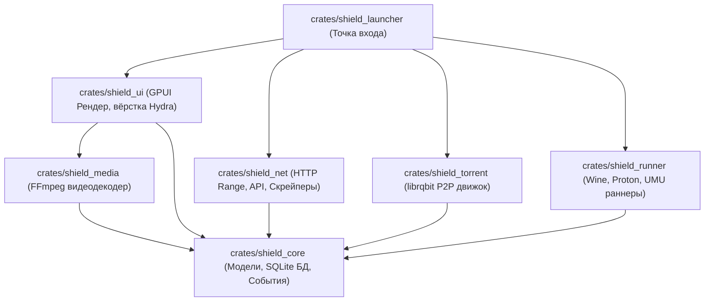

# Архитектурная спецификация: S.H.I.E.L.D Launcher (Pure Rust Port)

> **Статус:** В активной разработке (Миграция с Electron на чистый Rust)  
> **Рендерер:** Native GPU Acceleration (GPUI / Vulkan / DirectX / Metal)  
> **Визуальный дизайн:** 100% идентичность оригинальной вёрстке и стилям Hydra Launcher  
> **Мультимедиа:** Встроенная поддержка видеокодеков через bundled FFmpeg

---

## 1. Архитектурная концепция и цели

S.H.I.E.L.D Launcher — это высокопроизводительный игровой лаунчер нового поколения, переписанный на 100% чистом Rust. Проект полностью исключает прослойку Electron/Node.js/Chromium, обеспечивая:
- **Мгновенный холодный запуск:** <100 мс против 2–3 секунд.
- **Минимальный расход памяти:** <50 МБ RAM против 400–700 МБ в Electron.
- **Zero-Webview iGPU Rendering:** рендеринг интерфейса силами GPU (шейдеры и Taffy flexbox), освобождая ресурсы APU/iGPU для запущенных игр.
- **Встроенное декодирование видео:** поставка релизных сборок с бандлом кодеков FFmpeg для плавного воспроизведения трейлеров игр без зависимости от сторонних системных пакетов.

---

## 2. Модульная структура воркспейса (Crates)

### 2.1. Описание модулей

1. **`shield_core`:**
   - Доменные сущности: `Game`, `LibraryItem`, `DownloadTask`, `UserProfile`, `AppSettings`.
   - Локальная база данных: `rusqlite` (SQLite с пулом соединений, миграциями и строгой типизацией).
   - Шина событий: асинхронные каналы для нотификаций о статусе загрузок и процессах.

2. **`shield_ui` (Визуальный слой, идентичный Hydra):**
   - Точная репликация дизайн-системы и токенов Hydra (`src/renderer/src/scss/globals.scss`):
     - Background: `#121212`, Dark Background: `#0d0d0d`, Border: `rgba(255, 255, 255, 0.08)`.
     - Текст: `#d0d1d7`, Muted: `#f0f1f7`.
     - Акцент: `#16b195` (Brand Teal), `#3e62c0` (Brand Blue), `#30edc5` (Platinum Cyan).
   - Компоненты интерфейса:
     - `Header`: Кастомный заголовок окна, поисковая строка, аватар профиля, индикаторы сети.
     - `Sidebar`: Левая панель навигации (Каталог, Библиотека, Загрузки, Добавление своей игры).
     - `CatalogueView`, `LibraryView`, `GameDetailView`, `DownloadsView`, `SettingsView`.

3. **`shield_media` (Видеоплеер и FFmpeg кодек):**
   - Фоновый декодер видеопотоков на базе `ffmpeg` (`libavcodec`, `libavformat`, `libswscale`).
   - Чтение H.264 / WebM / VP9 трейлеров и декодирование в буфер RGBA кадров.
   - Вывод видеокадров напрямую в текстуру GPU через GPUI без просадок FPS.
   - Бандлинг: библиотеки FFmpeg упаковываются непосредственно в дистрибутив программы.

4. **`shield_net` & `shield_torrent`:**
   - Сетевой стек на `tokio` + `reqwest` с TLS через `rustls`.
   - Встроенный P2P клиент на базе `librqbit` с прямой записью на диск и контролем полосы.

5. **`shield_runner`:**
   - Запуск игр под Linux через Proton / Wine / UMU, отслеживание PID и учёт игрового времени.

---

## 3. Обработка крайних случаев и надёжность

- **Безопасность памяти и потоков:** строгая модель владения Rust (Zero Data Races).
- **Сбои сетевых потоков и загрузок:** автоматическое возобновление (HTTP Range resumption) и проверка контрольных сумм BLAKE3/SHA-256.
- **Отказоустойчивость декодера видео:** если видеопоток поврежден или недоступен, интерфейс бесшовно переключается на статичный постер/скриншот игры без падения приложения.
